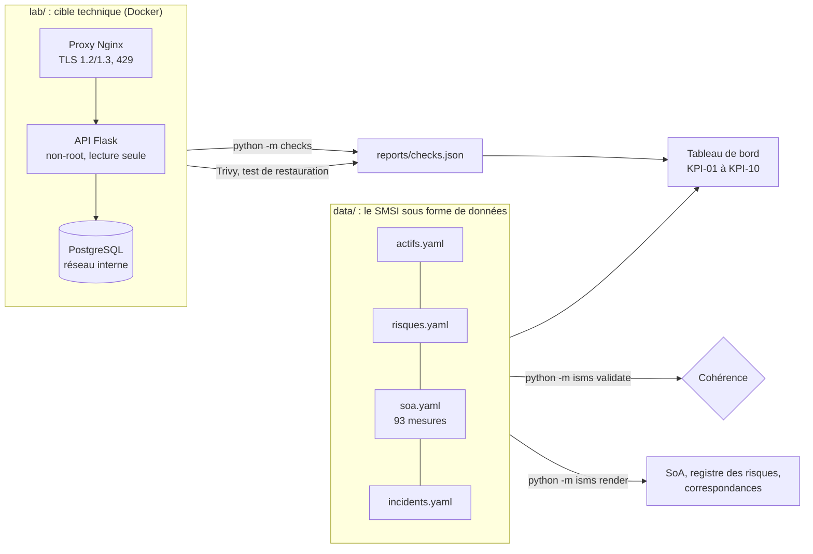

# KamaPay ISMS Lab : un SMSI ISO/IEC 27001 outillé pour un établissement de paiement mobile

[](https://github.com/Julionores/kamapay-isms-lab/actions/workflows/conformite.yml)

Ce dépôt construit le **système de management de la sécurité de l'information (SMSI)** de
KamaPay SA, un établissement de paiement de monnaie électronique mobile, et le **vérifie
en continu**. Les politiques, le registre des risques, la déclaration d'applicabilité et le
registre des incidents sont des données versionnées. Une API de paiement réelle, déployée
dans un lab Docker, sert de cible à 16 contrôles automatisés rattachés aux mesures de
l'annexe A. Chaque commit relance la validation, les contrôles et le tableau de bord.

> **Contexte fictif.** KamaPay SA, son actionnaire KamaTel et tous les chiffres
> (clients, incidents, montants) sont inventés pour l'exercice. Aucune donnée réelle n'est
> utilisée. Les correspondances réglementaires sont indicatives et doivent être validées
> par un juriste ou un auditeur avant tout usage réel.

## Ce que montre le projet

| Mission d'un ingénieur sécurité SI | Livrable dans ce dépôt |
|---|---|
| Mettre en place et maintenir un SMSI ISO 27001 | [PSSI](docs/01-gouvernance/PSSI.md), [périmètre](docs/00-contexte/perimetre-smsi.md), [rôles et RACI](docs/01-gouvernance/organisation-roles-raci.md), 10 politiques et 3 procédures |
| Élaborer et tenir à jour politiques et procédures | Métadonnées obligatoires (version, approbateur, date de revue) vérifiées par la CI : un document dont la revue est échue fait échouer le build |
| Assurer la cohérence avec les réglementations et les normes | [Déclaration d'applicabilité](docs/03-soa/declaration-applicabilite.md) des 93 mesures, [correspondance](docs/03-soa/correspondance-referentiels.md) avec COBIT 2019, ITIL 4, PCI DSS v4.0 et RGPD, [exigences légales](docs/00-contexte/parties-interessees-exigences.md) (COBAC/BEAC, loi camerounaise sur la cybersécurité) |
| Évaluer le risque cyber et animer la maîtrise des risques | [Méthodologie](docs/02-risques/methodologie-risques.md) et [registre de 14 risques](docs/02-risques/registre-des-risques.md) propres au mobile money (SIM swap, fraude d'agents, fuite KYC, SS7, BOLA), cartographies brute et résiduelle, plan de traitement |
| Identifier et déployer les contrôles | Lab durci (TLS, cloisonnement réseau, moindre privilège, masquage) et [16 contrôles automatisés](#contrôles-automatisés) |
| Intégrer la sécurité aux projets IT et réseaux | [Jalons sécurité du cycle projet](docs/04-securite-projets/securite-dans-les-projets.md), analyse statique et scan de vulnérabilités dans la CI |
| Gérer les incidents, tenir le registre, faire le reporting | [Procédure](docs/05-incidents/procedure-gestion-incidents.md), [registre de 8 incidents](data/incidents.yaml), [exercice sur table SIM swap](docs/05-incidents/exercices/EX-2026-01-sim-swap.md), [modèle de rapport](docs/05-incidents/modele-rapport-incident.md) |
| Préparer une stratégie de résilience du SI | [BIA](docs/06-resilience/bia.md), [PCA/PRA](docs/06-resilience/pca-pra.md) et un [test de restauration réellement exécuté](docs/06-resilience/rapport-test-restauration.md) : sauvegarde chiffrée, restauration sur instance vierge, contrôle d'intégrité |
| Sensibiliser et former | [Programme annuel](docs/07-sensibilisation/programme-sensibilisation.md), [quiz hameçonnage](docs/07-sensibilisation/quiz-phishing.md), [kit pour les agents distributeurs](docs/07-sensibilisation/kit-agents-distributeurs.md) |
| Mettre en place une veille sécurité | [Procédure de veille](docs/01-gouvernance/procedures/PROC-03-veille-securite.md) et modèle de bulletin |
| Piloter et rendre compte à la direction | [10 indicateurs](docs/08-pilotage/indicateurs-smsi.md), [tableau de bord généré](docs/08-pilotage/tableau-de-bord.md) avec tendance, [historique hebdomadaire des relevés](data/historique-kpi.yaml), [programme d'audit interne](docs/08-pilotage/programme-audit-interne.md), [revue de direction](docs/08-pilotage/revue-de-direction.md) |

## Architecture



Le principe : **une exigence n'est considérée comme satisfaite que si une preuve existe**.
Le validateur refuse une mesure « implémentée » sans preuve, une preuve qui pointe vers un
fichier absent, un risque résiduel au-delà de l'appétence sans acceptation de la direction,
un incident clos sans retour d'expérience, ou un lien cassé dans la documentation.

## Démarrage rapide

Prérequis : Python 3.11 ou plus récent, Docker avec Compose v2, `openssl`, `make`.

```bash
make install        # dépendances Python
make validate       # cohérence du SMSI
make test           # tests unitaires de l'outillage
make lab-up         # secrets, certificat et démarrage du lab sur https://127.0.0.1:8443
make scan           # scan Trivy de l'image de l'API
make restore-test   # sauvegarde chiffrée, restauration, contrôle d'intégrité
make checks         # 16 contrôles automatisés
make render kpi     # livrables et indicateurs à jour
make history        # enregistrer un relevé daté des indicateurs
make lab-down
```

`make all` enchaîne toutes les étapes. Exemple d'appel à l'API du lab :

```bash
curl --cacert lab/proxy/certs/server.crt -X POST https://127.0.0.1:8443/v1/auth/token \
     -H 'Content-Type: application/json' -d '{"msisdn": "237690004521", "pin": "1357"}'
```

## Contrôles automatisés

| Contrôle | Mesures ISO 27001 | Ce qui est vérifié |
|---|---|---|
| CHK-TLS-01 | 8.24, 5.14, 8.21 | TLS 1.0 et 1.1 refusés, TLS 1.2 et 1.3 acceptés |
| CHK-TLS-02 | 8.24, 8.21 | HSTS d'au moins 180 jours, certificat valide plus de 14 jours |
| CHK-HTTP-01 | 8.9 | En-têtes de sécurité (CSP, X-Frame-Options, nosniff…), version du serveur masquée |
| CHK-AUTH-01 | 8.5, 5.15, 8.29 | Routes protégées : 401 sans jeton ou avec un jeton forgé |
| CHK-AUTHZ-01 | 8.3, 5.18, 8.28, 8.29 | Autorisation au niveau objet : 403 sur le portefeuille d'un tiers (OWASP API1, BOLA) |
| CHK-MASK-01 | 8.11, 5.34 | MSISDN et numéro de pièce d'identité masqués dans les réponses |
| CHK-RATE-01 | 8.5, 8.16 | Force brute sur le PIN bloquée (HTTP 429) dès la 6e tentative |
| CHK-LOG-01 | 8.15, 5.28 | Journal d'audit JSON complet, aucune donnée personnelle en clair |
| CHK-DB-01 | 8.2, 8.3 | Rôle applicatif sans privilège d'administration, sans DELETE ni TRUNCATE, PIN non modifiable |
| CHK-NET-01 | 8.20, 8.22 | Seul le proxy est publié, la base est sur un réseau interne injoignable depuis l'hôte |
| CHK-CTR-01 | 8.9, 8.19 | Conteneurs non-root, en lecture seule, sans capacité, `no-new-privileges` |
| CHK-BKP-01 | 8.13, 5.30 | Test de restauration réussi depuis moins de 7 jours |
| CHK-VULN-01 | 8.8 | Aucune vulnérabilité critique corrigeable dans l'image (Trivy) |
| CHK-SAST-01 | 8.25, 8.28 | Aucun défaut de sévérité haute dans le code de l'API (Bandit) |
| CHK-SECRET-01 | 5.17, 8.4 | Aucun secret dans les fichiers versionnés, fichiers sensibles exclus de git |
| CHK-DOC-01 | 5.1, 5.36, 5.37 | Documents identifiés, approuvés, liens valides, revues non échues |

Les contrôles sont déclarés dans [`checks/`](checks/) et référencés dans la SoA. Le
validateur échoue si la SoA cite un contrôle qui n'existe pas.

## Structure du dépôt

```
data/        référentiels du SMSI (actifs, risques, SoA, incidents, sensibilisation, historique)
schemas/     schémas JSON de ces référentiels et des métadonnées documentaires
docs/        documentation du SMSI (contexte, gouvernance, risques, SoA, projets,
             incidents, résilience, sensibilisation, pilotage)
isms/        outillage : validation, génération des livrables, indicateurs
checks/      contrôles automatisés rattachés aux mesures de l'annexe A
lab/         API de paiement, proxy TLS, base PostgreSQL, scripts (secrets, restauration)
tests/       tests unitaires de l'outillage
.github/     intégration continue (à chaque commit ; chaque lundi, relevé des indicateurs committé)
```

## Limites assumées

- Le lab reproduit une architecture de paiement **simplifiée** ; il ne remplace ni un test
  d'intrusion ni un audit de certification.
- Les mesures physiques (chapitre 7) et RH reposent sur des preuves « hors dépôt »
  (rapports ISAE 3402 des hébergeurs, procédures RH), signalées comme telles dans la SoA.
- Le tableau de bord montre volontairement des indicateurs **non atteints** (délai de
  détection, taux de formation des agents) : un SMSI crédible expose ses écarts et les
  relie à des actions (PA-01 à PA-08).

## Auteur

**Junior TSAFACK** : Master 2 Sécurité des systèmes d'information, ISO/IEC 27001 Information
Security Associate, ISC2 CC, AWS Solutions Architect Associate.
Site : [blog.jtmcloud.com](https://blog.jtmcloud.com), dont le
[module de formation « SMSI ISO 27001 pour un établissement de paiement »](https://blog.jtmcloud.com/securite/17-smsi-etablissement-paiement/01-introduction-smsi/)
explique la démarche · [LinkedIn](https://linkedin.com/in/junior-tsafack-megnekeu-b673151b9)

Licence : [MIT](LICENSE).
